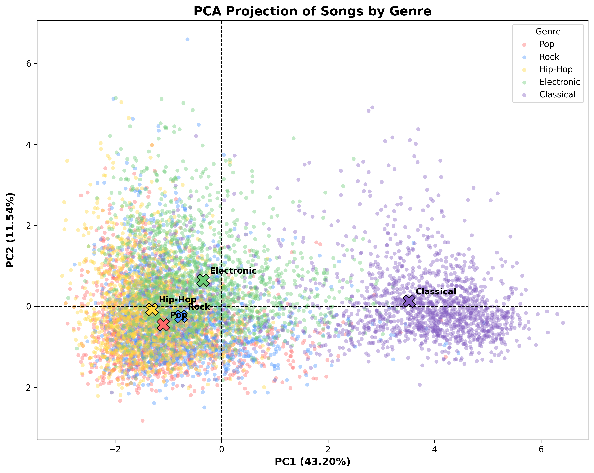
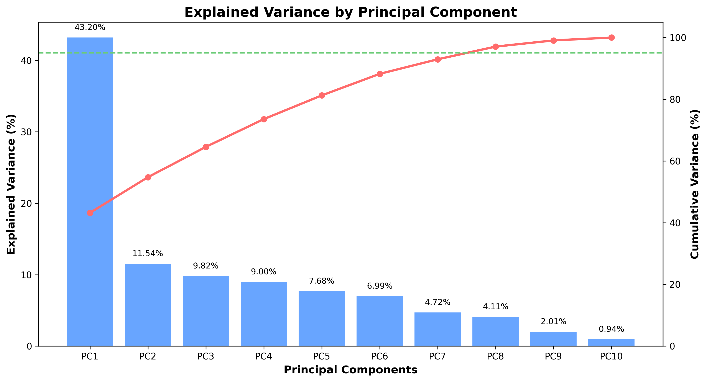
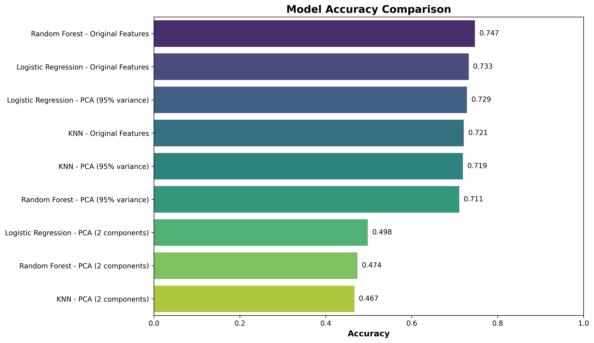
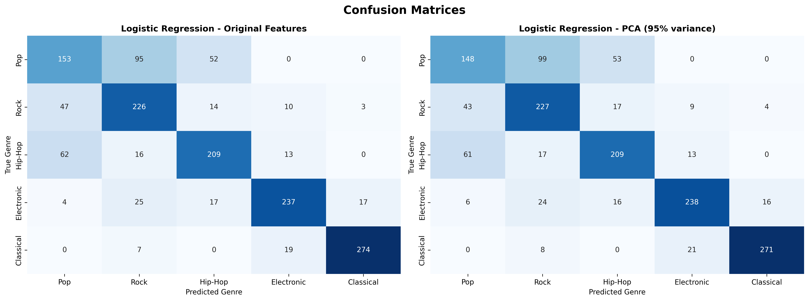

# Spotify Audio Features Analysis: PCA Visualization and Genre Prediction

This project combines **Principal Component Analysis (PCA)** and **machine learning** to study whether Spotify audio features can be used to distinguish music genres.

Instead of using a small classroom dataset such as Iris, the project uses a more modern and GitHub-friendly topic: **songs**. The idea is simple:

- use Spotify audio features to understand the structure of the data
- reduce dimensionality with PCA
- visualize songs in 2D
- compare genre classification before and after PCA

## Project question

**Can Spotify audio features be used to visualize and predict song genres, and how much information is lost after applying PCA?**

## Dataset

- Source: [SpotifyFeatures.csv](https://raw.githubusercontent.com/sushmaakoju/spotify-tracks-data-analysis/main/SpotifyFeatures.csv)
- Original source type: public Spotify audio-features dataset shared through GitHub
- Final local dataset used in this project: [`data/spotify_tracks_selected.csv`](data/spotify_tracks_selected.csv)
- Number of tracks used: `7500`
- Number of genres used: `5`
- Tracks per genre: `1500`

### Selected genres

- `Pop`
- `Rock`
- `Hip-Hop`
- `Electronic`
- `Classical`

### Why only five genres?

The original dataset contains many genres, but keeping all of them would make the PCA plot noisy and the classification task harder to explain. A balanced subset of five well-known genres makes the project:

- easier to visualize
- faster to run
- easier to defend orally
- cleaner for GitHub presentation

## Features used

The project uses the following numerical features:

- `danceability`
- `energy`
- `loudness`
- `speechiness`
- `acousticness`
- `instrumentalness`
- `liveness`
- `valence`
- `tempo`
- `popularity`

These variables are all quantitative, which makes them suitable for PCA.

## Method

### PCA workflow

1. Load the balanced Spotify subset.
2. Keep the selected numerical audio features.
3. Standardize the data.
4. Compute the correlation matrix.
5. Compute eigenvalues, explained variance, and cumulative variance.
6. Project songs onto the principal components.
7. Study variable loadings and contributions.
8. Visualize the songs in the plane `(PC1, PC2)`.

### Machine learning workflow

Three classifiers are compared:

- Logistic Regression
- KNN
- Random Forest

Each one is trained on:

- the original audio features
- only `2` PCA components
- PCA components retaining `95%` of the variance

## Key PCA results

- `PC1 = 43.20%`
- `PC2 = 11.54%`
- `PC1 + PC2 = 54.74%`
- `8` principal components are needed to retain at least `95%` of the variance

### Main interpretation

- `PC1` is driven mainly by `loudness`, `energy`, and `acousticness`
- `PC2` is driven mainly by `liveness`, `tempo`, and `popularity`
- `Classical` tracks appear much more separated than the other genres in the PCA plot

## Model results

| Experiment | Accuracy |
|---|---:|
| Random Forest - Original Features | 0.7473 |
| Logistic Regression - Original Features | 0.7327 |
| Logistic Regression - PCA (95% variance) | 0.7287 |
| KNN - Original Features | 0.7213 |
| KNN - PCA (95% variance) | 0.7193 |
| Random Forest - PCA (95% variance) | 0.7107 |
| Logistic Regression - PCA (2 components) | 0.4980 |
| Random Forest - PCA (2 components) | 0.4740 |
| KNN - PCA (2 components) | 0.4667 |

## Main conclusion

This project shows two important things:

1. **PCA is very useful for visualization and interpretation.**
   The 2D PCA plot makes the structure of the song data easier to understand, especially the separation of Classical tracks.

2. **PCA can preserve most of the predictive information if we keep enough components.**
   When PCA keeps `95%` of the variance, the classification accuracy stays very close to the original features for Logistic Regression and KNN.

At the same time, using only `2` principal components causes a strong drop in accuracy. So the project supports a clear and honest conclusion:

**PCA is excellent for visualization, but too much dimensionality reduction can hurt classification performance.**

## Project structure

```text
spotify-pca-genre-prediction/
├── data/
│   └── spotify_tracks_selected.csv
├── images/
│   ├── confusion_matrices_logistic.png
│   ├── correlation_circle.png
│   ├── correlation_heatmap.png
│   ├── explained_variance.png
│   ├── model_accuracy_comparison.png
│   └── pca_scatter.png
├── notebook/
│   └── spotify_pca_ml.ipynb
├── outputs/
│   ├── classification_reports.txt
│   ├── correlation_matrix.csv
│   ├── genre_centroids_pc1_pc2.csv
│   ├── model_comparison.csv
│   ├── pca_feature_contributions.csv
│   ├── pca_feature_quality_cos2.csv
│   ├── pca_loadings.csv
│   ├── pca_scores_pc1_pc2.csv
│   ├── pca_summary.csv
│   └── standardized_features.csv
├── src/
│   ├── prepare_spotify_subset.py
│   └── spotify_pca_ml.py
├── oral_defense_notes.md
├── report.md
├── requirements.txt
└── run_project.py
```

## How to run

Install dependencies:

```bash
python3 -m pip install -r requirements.txt
```

Rebuild the balanced dataset if needed:

```bash
python3 src/prepare_spotify_subset.py
```

Run the full project:

```bash
python3 run_project.py
```

Open the notebook:

```bash
notebook/spotify_pca_ml.ipynb
```

## Notebook and Colab

The notebook is already prepared here:

- [`notebook/spotify_pca_ml.ipynb`](notebook/spotify_pca_ml.ipynb)

If you use Google Colab, upload the whole project folder to Google Drive, mount your Drive, then open the notebook from there.

## Visuals

### PCA projection



### Explained variance



### Model comparison



### Confusion matrices


